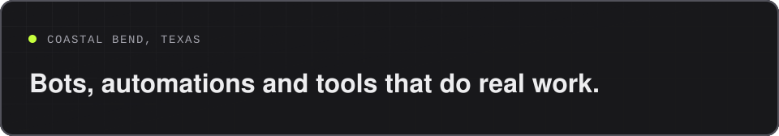
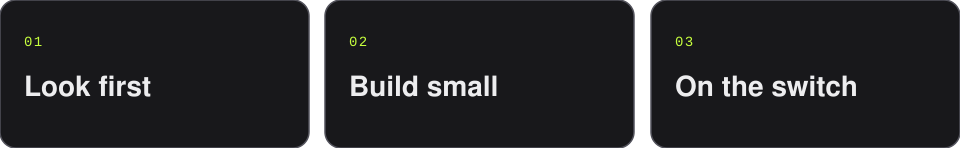

# Josh McCoy

Tradesman turned builder. I spent years building with my hands. Now I build software the same way: look at the job first, make the smallest thing that works, and keep it running.

I wrote my first code in 2004. Along the way I built a company, Dad Can't Draw, and sold it.

## Where to look

- [joshmccoy.dev](https://joshmccoy.dev). The workshop. Things I've built, mostly to run my own business.
- [j0sh.wtf](https://j0sh.wtf). The hub. AI tools, minus the hype, and the case studies.
- [How I run my work](https://j0sh.wtf/case-studies/bot-team/). Assistants handle pieces of my week. Each one has a single job. Nothing sends, posts or spends money until I say so.
- [McCoy Built](https://mccoybuilt.com). Hands-on AI teaching for business owners.

## McCoy Built

[McCoy Built AI Solutions](https://mccoybuilt.com) is a month-to-month retainer for business owners in the Coastal Bend. Two 45-minute calls a month, and a direct line between them. I teach you and your team to put AI on the jobs you already do.

I don't sell websites.

Work inquiries: [josh@mccoybuilt.com](mailto:josh@mccoybuilt.com)

## How I build

Same as a job site. Measure twice, build what's needed, clean up after.

1. Look at the job first. I watch how the work gets done before I write anything.
2. Build the smallest thing that works. One tool, one job.
3. Keep a person on the switch. Nothing sends, posts or spends money until I say so.
